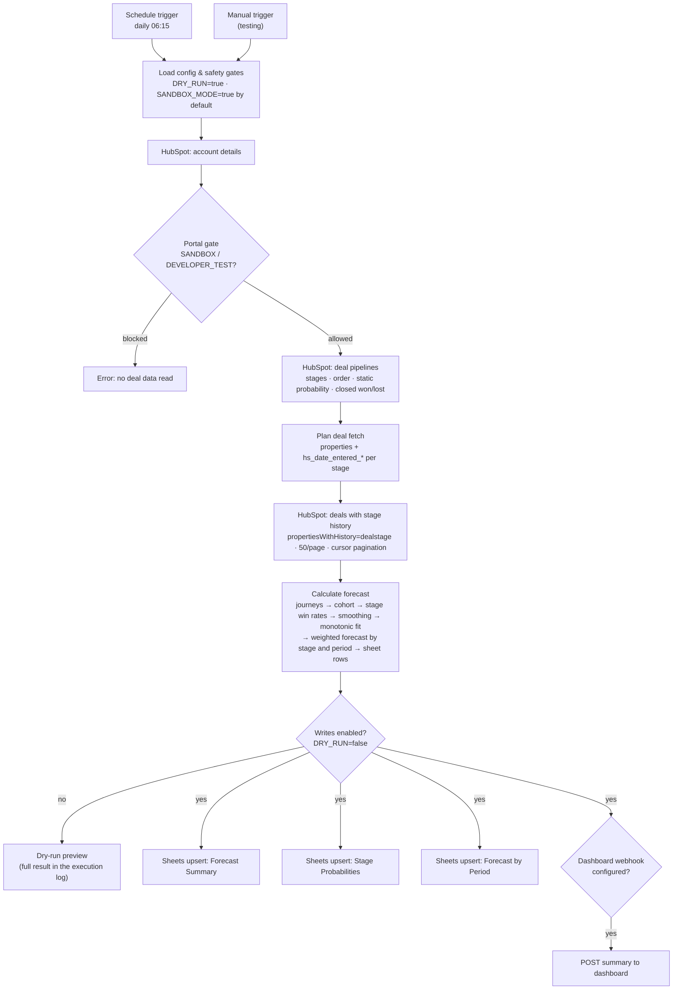

# n8n-hubspot-probability-weighted-forecast-calculator

A scheduled revenue analytics pipeline for **n8n** and **Node.js**. It replaces the static stage percentages configured in HubSpot with **dynamic win probabilities learned from my own deal-stage history**, applies them to every open deal, and upserts a probability-weighted forecast (by pipeline, by stage, and by close-date period) into **Google Sheets**, where executive dashboards can read it. An optional webhook pushes the summary to any other dashboard.

I built it fail-safe. On import, **`DRY_RUN=true` and `SANDBOX_MODE=true`**:

- Nothing is written to any spreadsheet or dashboard.
- HubSpot is only read after the portal is verified as a sandbox or developer test account.
- Production deals and the production spreadsheet need a third, explicit opt-in.

The repository contains **no credentials, tokens, spreadsheet IDs, or placeholder secrets**. `workflow.json` has no credential references at all (I select my own after import), and every secret in `.env.example` ships blank.

---

## Contents

- [System overview & business value](#system-overview--business-value)
- [Example output](#example-output)
- [Architecture & data flow](#architecture--data-flow)
- [Forecast methodology](#forecast-methodology)
- [Google Sheets output schema](#google-sheets-output-schema)
- [Repository layout](#repository-layout)
- [Environment variables](#environment-variables)
- [Installation & n8n import guide](#installation--n8n-import-guide)
- [Safety gates and modes](#safety-gates-and-modes)
- [Edge-case handling](#edge-case-handling)
- [Testing and the security scan](#testing-and-the-security-scan)
- [Disclaimer & Liability Limitation](#️-disclaimer--liability-limitation)
- [License](#license)
- [Author](#author)

---

## System overview & business value

HubSpot's built-in weighted pipeline multiplies each deal's amount by a fixed probability per stage, such as 20%, 40%, 60%, 80%, 90%. Those numbers are set once, by hand, and rarely revisited. In most portals they drift far from reality: early stages are usually too optimistic, and late stages sometimes too pessimistic. The forecast built on them inherits the error.

This calculator answers a better question for every stage: **of the deals that actually reached this stage and have since closed, what share were won?** It learns that from the deal-stage history HubSpot already records, then:

- **Corrects the forecast.** Open pipeline is weighted by observed conversion, not by assumptions.
- **Shows the gap.** Every run reports the static and the dynamic forecast side by side, plus the difference.
- **Exposes the funnel.** Stage-to-next conversion and advancement rates show where deals leak.
- **Stays honest about uncertainty.** Small samples are shrunk toward the configured probability, every rate carries a 90% confidence interval, and thin stages are flagged as low-confidence.
- **Feeds dashboards.** Idempotent daily rows in Google Sheets are a clean source for executive reporting; re-running a day updates its rows instead of duplicating them.

---

## Example output

From `npm run dry-run` on the synthetic fixture (Sales Pipeline, 84 closed deals in the last 365 days, 20 open deals):

| Stage | Static | Observed win rate | Dynamic | Closed deals that reached it | Next-stage conversion | Open amount | Dynamic weighted |
| --- | --- | --- | --- | --- | --- | --- | --- |
| Appointment Scheduled | 20% | 14.3% | 14.9% | 77 | 59.7% | $295,000 | $44,080 |
| Qualified To Buy | 40% | 17.0% | 20.6% | 53 | 47.2% | $201,000 | $41,476 |
| Presentation Scheduled | 60% | 27.6% | 35.9% | 29 | 55.2% | $188,000 | $67,487 |
| Decision Maker Bought-In | 80% | 55.0% | 63.3% | 20 | 60.0% | $113,000 | $71,567 |
| Contract Sent | 90% | 92.3% | 91.3% | 13 *(low confidence)* | — | $159,000 | $145,174 |

| Open pipeline | Static weighted | **Dynamic weighted** | Delta |
| --- | --- | --- | --- |
| $956,000 | $485,700 | **$369,784** | −$115,916 (−23.9%) |

In this data set the static percentages overstate the forecast by almost a quarter, mostly in the middle stages.

---

## Architecture & data flow



In words:

1. A **schedule trigger** (daily at 06:15 by default) or a manual trigger starts the run.
2. **Load Config & Safety Gates** reads the environment and applies the fail-safe defaults. It refuses to start in production without the explicit opt-in.
3. **HubSpot: Account Details** and **Enforce Portal Gate** confirm, before any deal data is read, that the connected portal is a sandbox or developer test account whenever `SANDBOX_MODE=true`.
4. **HubSpot: Deal Pipelines** loads stage order, static probabilities, and closed-won / closed-lost markers.
5. **HubSpot: Deals with Stage History** pages through every deal (50 per page, the HubSpot maximum when history is requested), including the full `dealstage` change history and each stage's `hs_date_entered_*` timestamp.
6. **Calculate Forecast**, a Code node running `src/calculator.js`, builds the journeys, stage statistics, and forecast, and produces the rows for three sheet tabs.
7. **Writes Enabled?** routes either to a dry-run preview or to three **Google Sheets append-or-update** nodes, keyed on `row_key`, plus the optional dashboard webhook.

There is one source of truth. The config gates and the forecast math live in `src/` inside `// <n8n-core:…>` markers, and `scripts/build-workflow.js` embeds those exact regions into the n8n Code nodes. The tests fail if `workflow.json` drifts from `src/`, and they run the n8n Code nodes in a sandbox to prove they produce rows identical to the standalone calculator.

---

## Forecast methodology

For each pipeline:

**1. Journeys.** For every deal I rebuild the ordered list of stages it actually entered, from `propertiesWithHistory.dealstage`. If a deal has no history, I use the `hs_date_entered_<stageId>` properties, and as a last resort its current stage. Stages from other pipelines (deals that were moved) are ignored.

**2. Cohort.** The cohort is closed deals (won or lost) whose close date falls within `LOOKBACK_DAYS` (default 365). Open deals are deliberately **excluded** from the rates, because their outcome is unknown. Counting them as "not won" would bias every rate downward.

**3. Stage statistics.** For each open stage *s*:

| Metric | Definition |
| --- | --- |
| `sample_size` | Closed-cohort deals that entered *s* |
| `wins` | Of those, deals that closed won |
| `observed_win_rate` | wins ÷ sample_size, which is P(win \| reached *s*) |
| `next_stage_conversion` | Share of sample_size that entered the next open stage |
| `advancement_rate` | Share that entered **any** later open stage or closed won (stage skips count; moving to closed lost does not) |
| `ci90_low` / `ci90_high` | Wilson score 90% interval on the observed rate |

I use "eventual win given the stage was reached" rather than multiplying stage-to-stage rates, because a multiplied chain breaks when deals skip stages. The stage-to-stage rates are still reported for funnel analysis.

**4. Smoothing.** Thin stages would otherwise swing wildly, so each rate is shrunk toward the stage's static HubSpot probability with a Beta prior of strength *k* (`PRIOR_STRENGTH`, default 10):

```text
smoothed(s) = (wins + k × static(s)) / (sample_size + k)
```

With *k* = 0 the rate is raw history. With *k* = 10, a stage with 10 closed deals is weighted half on history and half on the configured probability. As *k* grows, the forecast converges to HubSpot's static one.

**5. Monotonicity.** A deal that advances should not become *less* likely to win. With `ENFORCE_MONOTONIC=true` (the default), I fit a non-decreasing curve across stage order with weighted pool-adjacent-violators, weighted by sample_size + *k*. Any stage that was adjusted is flagged `monotonic_adjusted`.

**6. Forecast.** Each open deal contributes `amount × dynamic_probability(current stage)`. The static forecast uses `amount × static_probability`. Amounts use `amount_in_home_currency` when HubSpot provides it, otherwise `amount`. Results are grouped by stage and by close-date period (`FORECAST_PERIOD` = month or quarter, `FORECAST_PERIODS_AHEAD` periods). Deals outside that window go into `past_due`, `later`, or `unscheduled`.

---

## Google Sheets output schema

Three tabs, all upserted on `row_key`, so re-running the same day updates rows instead of appending duplicates. The standalone engine creates missing tabs and header rows. In n8n I create each tab with the header row below before the first write.

**Forecast Summary** (`SUMMARY_TAB`). One row per pipeline per run date, plus an `__all__` row when more than one pipeline is forecast.

| Column | Meaning |
| --- | --- |
| `row_key` | `run_date\|pipeline_id` |
| `run_date`, `run_at`, `write_mode` | Report date (in `REPORT_TIMEZONE`), timestamp, and `sandbox` or `production` |
| `pipeline_id`, `pipeline_name` | Pipeline identity |
| `open_deals`, `open_amount` | Open deals and their total amount |
| `static_weighted_forecast` | Σ amount × static probability |
| `dynamic_weighted_forecast` | Σ amount × dynamic probability |
| `forecast_delta`, `forecast_delta_pct` | Dynamic − static, and as a share of static |
| `cohort_closed_deals`, `cohort_win_rate` | Size and overall win rate of the historical cohort |
| `lookback_days`, `prior_strength` | Parameters used for this run |
| `low_confidence_stages` | Open stages with fewer than `MIN_SAMPLE_SIZE` closed deals |
| `deals_missing_amount`, `overdue_open_deals` | Data-hygiene counters |
| `history_coverage_pct` | Share of cohort deals with stage history or date-entered data |

**Stage Probabilities** (`STAGE_TAB`). One row per stage, per pipeline, per run date.

`row_key`, `run_date`, `pipeline_id`, `pipeline_name`, `stage_order`, `stage_id`, `stage_name`, `static_probability`, `observed_win_rate`, `smoothed_probability`, `dynamic_probability`, `ci90_low`, `ci90_high`, `sample_size`, `wins`, `next_stage_conversion`, `advancement_rate`, `low_confidence`, `monotonic_adjusted`, `open_deals`, `open_amount`, `static_weighted`, `dynamic_weighted`

**Forecast by Period** (`PERIOD_TAB`). One row per period bucket, per pipeline, per run date.

`row_key`, `run_date`, `pipeline_id`, `pipeline_name`, `period` (`past_due`, `2026-11` … or `2026-Q4` …, `later`, `unscheduled`), `open_deals`, `open_amount`, `static_weighted`, `dynamic_weighted`

All values are written **RAW** (never evaluated as formulas). Pipeline and stage labels that begin with `=`, `+`, `-`, or `@` are prefixed with a space, so a CRM label can never inject a spreadsheet formula.

---

## Repository layout

```text
n8n-hubspot-probability-weighted-forecast-calculator/
├── README.md                    This file
├── DISCLAIMER.md                Full disclaimer and liability limitation
├── LICENSE                      MIT © 2026 dhRobin Systems
├── workflow.json                Importable n8n workflow (generated from src/, no credentials)
├── package.json                 Zero dependencies; node --test
├── .env.example                 Configuration template (secrets blank)
├── .gitignore
├── scripts/
│   └── build-workflow.js        Regenerates / checks workflow.json from src/
├── src/
│   ├── calculator.js            Core math: journeys, cohort, win rates, smoothing, isotonic fit, forecast, rows
│   ├── config.js                Fail-safe environment loader and portal gate
│   └── index.js                 Standalone runner: HubSpot pagination, Sheets upsert (service account), CLI
└── test/
    ├── calculator.test.js       47 tests incl. n8n parity and repository security scan
    └── fixtures/
        └── hubspot-deals-mock.json   Synthetic account, pipelines, and 3 pages of deals with history
```

---

## Environment variables

These mirror `.env.example`. In n8n I set them as instance environment variables. HubSpot and Google access come from n8n credentials, not from these variables.

| Variable | Default | Purpose |
| --- | --- | --- |
| `DRY_RUN` | `true` | Calculate and preview only; write nothing |
| `SANDBOX_MODE` | `true` | Sandbox portal only; sandbox spreadsheet only |
| `ALLOW_PRODUCTION_MODE` | `false` | Required for `SANDBOX_MODE=false` |
| `HUBSPOT_ACCESS_TOKEN` | *(blank)* | Private app token, standalone engine only (scope `crm.objects.deals.read`) |
| `HUBSPOT_BASE_URL` | HubSpot API | Must be `https://` |
| `HUBSPOT_SANDBOX_PORTAL_ID` | *(blank)* | Optional pin to one sandbox portal |
| `PIPELINE_IDS` | *(blank: all)* | Comma-separated pipeline IDs to forecast |
| `MAX_DEAL_PAGES` | `200` | Maximum pages of 50 deals per run; truncation is reported |
| `LOOKBACK_DAYS` | `365` | Closed-deal cohort window (30–1825) |
| `PRIOR_STRENGTH` | `10` | Beta prior strength toward static probabilities (0 = raw history) |
| `MIN_SAMPLE_SIZE` | `20` | Below this, a stage is flagged low-confidence |
| `ENFORCE_MONOTONIC` | `true` | Non-decreasing win probability by stage order |
| `FORECAST_PERIOD` | `month` | `month` or `quarter` |
| `FORECAST_PERIODS_AHEAD` | `6` | Number of period buckets from the current one |
| `REPORT_TIMEZONE` | `UTC` | IANA zone for run dates and period boundaries |
| `GOOGLE_SHEETS_ID` | *(blank)* | Production spreadsheet ID |
| `GOOGLE_SHEETS_SANDBOX_ID` | *(blank)* | Sandbox spreadsheet ID (must differ from production) |
| `GOOGLE_SERVICE_ACCOUNT_FILE` | *(blank)* | Standalone engine only: path to a service account key kept outside the repo |
| `SUMMARY_TAB` / `STAGE_TAB` / `PERIOD_TAB` | `Forecast Summary` / `Stage Probabilities` / `Forecast by Period` | Tab names |
| `DASHBOARD_WEBHOOK_URL` | *(blank)* | Optional HTTPS endpoint for the summary JSON |

---

## Installation & n8n import guide

### 1. Prerequisites

- Node.js 18.18 or later (developed and tested on Node 22). There are no dependencies, so no `npm install` is needed.
- n8n 1.x.
- A **HubSpot developer test account or sandbox portal** with a private app holding `crm.objects.deals.read`. The pipelines endpoint is covered by deal read access in most portals; if HubSpot returns a scope error, the response names the scope it wants. The gate also calls HubSpot's account-info details endpoint.
- Two Google spreadsheets: a **sandbox** sheet for testing and a **production** sheet.

### 2. Run it offline first

```bash
npm test           # 47 tests, including the security scan
npm run dry-run    # full calculation on the synthetic fixture; writes nothing
```

`npm run dry-run` uses no credentials and no network. The `--fixture` flag is refused whenever writes are enabled, so recorded data can never reach a real spreadsheet.

### 3. Dry run against my sandbox portal

```bash
cp .env.example .env
# set HUBSPOT_ACCESS_TOKEN to the sandbox private app token
node --env-file=.env src/index.js
```

The output shows every summary, stage, and period row that would be written.

### 4. Import into n8n

1. **Workflows → Import from File** → select `workflow.json`. It imports **inactive**.
2. Open each HubSpot node (**Account Details**, **Deal Pipelines**, **Deals with Stage History**) and choose a **HubSpot App Token** credential for the *sandbox* private app. The workflow ships with no credential references, so n8n asks me to pick one.
3. Open each **Google Sheets** node and choose a **Google Sheets OAuth2** (or service account) credential with access to both spreadsheets.
4. In both spreadsheets, create the three tabs with the header rows listed under [Google Sheets output schema](#google-sheets-output-schema). `row_key` must be a column, because it is the matching column.
5. Set the n8n environment variables: at minimum `GOOGLE_SHEETS_SANDBOX_ID`, plus any method settings I want to change. If `$env` access is blocked in Code nodes (`N8N_BLOCK_ENV_ACCESS_IN_NODE=true`), the config node falls back to the fail-safe defaults, which means dry run in sandbox mode.
6. Click **Execute Workflow** with the manual trigger. With the defaults, the run ends at **Dry Run Preview (No Writes)**, and the full result is on the **Calculate Forecast** output.
7. Adjust the **Daily Forecast Schedule** cron (`15 6 * * *`) if needed, then activate.

### 5. Go live in stages

1. `DRY_RUN=true`, `SANDBOX_MODE=true`: review previews.
2. `DRY_RUN=false`, `SANDBOX_MODE=true`: write to the **sandbox spreadsheet** from a verified sandbox portal. Reconcile against HubSpot's own weighted amount.
3. `SANDBOX_MODE=false`, `ALLOW_PRODUCTION_MODE=true`, production HubSpot credential selected: production deals and the production spreadsheet. Only after the checklist in [DISCLAIMER.md](DISCLAIMER.md).

---

## Safety gates and modes

| `DRY_RUN` | `SANDBOX_MODE` | `ALLOW_PRODUCTION_MODE` | HubSpot reads | Writes |
| --- | --- | --- | --- | --- |
| `true` *(default)* | `true` *(default)* | any | Verified sandbox / developer-test portal | None (preview) |
| `false` | `true` | any | Verified sandbox portal | `GOOGLE_SHEETS_SANDBOX_ID` only |
| any | `false` | `false` *(default)* | — | **Refuses to start** |
| `true` | `false` | `true` | Production portal | None (preview) |
| `false` | `false` | `true` | Production portal | `GOOGLE_SHEETS_ID` |

More fail-safes:

- Only the literal string `false` disables `DRY_RUN`, `SANDBOX_MODE`, or `ENFORCE_MONOTONIC`. Typos, `0`, `no`, and empty values leave them **on**.
- Sandbox writes refuse to start without a sandbox spreadsheet, and the production and sandbox spreadsheets must be different.
- The portal gate runs before any deal data is read. If the account details call fails, the run stops.
- A test walks the workflow graph and fails if any Google Sheets or dashboard node can be reached without **Writes Enabled?**, or if any deal or pipeline request can be reached without passing **Enforce Portal Gate**.

---

## Edge-case handling

| Situation | What happens |
| --- | --- |
| Stage with few or no closed deals | Rate shrinks toward the static probability; flagged `low_confidence`; with no history, the static probability is used |
| Historical rates fall at a later stage | Monotonic fit pools the stages; `monotonic_adjusted=true` |
| Deals skip stages | They count only for the stages they entered; advancement rate still credits the skip |
| Deal moved between pipelines | History stages from other pipelines are ignored |
| Deal without `propertiesWithHistory` | `hs_date_entered_*` timestamps, then the current stage, are used |
| Open deals | Excluded from rates (no right-censoring bias); included in the forecast |
| Closed deals older than `LOOKBACK_DAYS` | Excluded from the cohort |
| Deal without an amount | Counted in `open_deals` and `deals_missing_amount`; adds no value |
| Mixed currencies without a home-currency amount | Warning `mixed_deal_currencies_without_home_currency_amount` |
| Close date in a previous period | `past_due` bucket; also counted in `overdue_open_deals` if before today |
| No close date / beyond the horizon | `unscheduled` / `later` buckets |
| Deal in an unknown or archived stage | Excluded from the forecast; warning with a count |
| Deals in pipelines not selected | Counted as `dealsOutsideSelectedPipelines` and skipped |
| Pipeline without a closed-won stage | Warning; all its stage rates are 0 |
| More deals than `MAX_DEAL_PAGES × 50` | Fetch stops; warning `deal_fetch_truncated_at_max_pages` |
| HubSpot or Google 429 / 5xx | Retries with `Retry-After` / backoff (standalone); n8n nodes retry three times |
| Re-running the same day | Rows are updated in place by `row_key`, not duplicated |
| Pipeline or stage label beginning with `=` | Neutralized; values written RAW |
| Missing tab (standalone engine) | Created, with the header row written automatically |

---

## Testing and the security scan

```bash
npm test                 # node --test test/calculator.test.js
npm run check:workflow   # confirms workflow.json matches src/
npm run build:workflow   # regenerates workflow.json after editing src/
```

The suite (47 tests, zero dependencies) covers:

- **Config gates:** defaults, strict flags, the production opt-in, spreadsheet separation, validation, and the portal gate.
- **Journeys:** history ordering, cross-pipeline stages ignored, and the date-entered and current-stage fallbacks.
- **Math against hand-computed values:** raw rates, Beta smoothing (and convergence to static at a large *k*), a Wilson interval checked against an independent calculation, low-confidence flags, pool-adjacent-violators, monotonic enforcement, and the static fallback.
- **Forecast:** weighted totals, period buckets (past due, later, unscheduled, missing amount), quarters, time-zone boundaries, exact column sets, and formula-injection neutralization.
- **Fixture (120 deals, 3 pages, 2 pipelines):** totals reconcile across stages, periods, and pipelines; probabilities are monotonic; history and date-entered paths agree; the result is deterministic and independent of page order.
- **Runner:** a dry run makes zero writes, the gate stops before deal reads, sandbox writes target only the sandbox sheet, pagination and truncation, 429 retry, RS256 service-account JWT verification, and the Sheets upsert (update, append, header extension, RAW, tab creation).
- **n8n workflow:** in sync with `src/`, inactive, **no credential references or placeholders**, config defaults with `$env` open and blocked, gate behaviour, Code-node output identical to `src/` on the fixture, and gate topology.
- **Security scan:** walks every file and fails on private key blocks, service account JSON, HubSpot tokens and legacy keys, Google OAuth and API keys, spreadsheet URLs with IDs, AWS, GitHub, and Slack tokens, JWTs, hard-coded secret assignments, any placeholder-credential marker, a committed `.env`, non-blank secrets in `.env.example`, email addresses outside RFC 2606 domains (plus the author contact), and domains outside RFC 2606 or a short allowlist (the author links, the HubSpot API host, and the Google API host). The scan also tests itself against planted secrets.

---

## ⚠️ Disclaimer & Liability Limitation

> **Disclaimer & Liability Limitation:**
> The code, templates, and workflows in this repository are provided "as-is", without warranty of any kind, express or implied. I disclaim all liability for any direct, indirect, incidental, or consequential damages arising from the use of this software, including but not limited to CRM data corruption, API rate limit exhaustion, billing discrepancies, or pipeline miscalculations.
>
> Users and administrators are solely responsible for ensuring full compliance with applicable data privacy and regulatory frameworks (including GDPR, CCPA, and CAN-SPAM), verifying webhook security, and conducting thorough testing in isolated sandbox environments prior to deploying any automated revenue infrastructure to production portals.

**Use at your own risk.** The code, workflows, and scripts provided in this repository (`n8n-hubspot-probability-weighted-forecast-calculator`) are for educational and architectural demonstration purposes.

* **No Liability:** The author and dhRobin Systems assume no responsibility or liability for any direct, indirect, incidental, or consequential damages resulting from the use, misuse, or deployment of these scripts, including inaccurate forecasts, pipeline miscalculations, and downstream financial or commercial decisions.
* **No Warranty:** All software, n8n JSON blueprints, and JavaScript modules are provided "AS IS" without warranty of any kind, express or implied, including but not limited to merchantability, fitness for a particular purpose, or non-infringement.
* **Forecasts Are Estimates:** Probability-weighted figures are statistical estimates based on past conversion. They are not commitments, and they should not be the sole basis for financial reporting, guidance, or compensation decisions.
* **Production Testing Required:** Always test thoroughly in an isolated staging environment (for example a HubSpot developer test account or sandbox) with `SANDBOX_MODE=true` and `DRY_RUN=true` enabled before connecting live HubSpot credentials. Treat every spreadsheet write as one that cannot be undone, and reconcile the output against HubSpot before relying on it.
* **Third-Party APIs & Compliance:** Users are solely responsible for complying with the terms of service, rate limits, data privacy regulations (GDPR/CCPA), and security policies of HubSpot, Google, and any connected services. That includes controlling access to the spreadsheet and dashboard, securing any webhook endpoint that receives forecast data, and keeping tokens and service account keys out of source control.

The full disclaimer is also available in [DISCLAIMER.md](https://github.com/dhrobinsystems/n8n-hubspot-probability-weighted-forecast-calculator/blob/main/DISCLAIMER.md).

## License

Released under the MIT License. Copyright (c) 2026 DH Robin (dhRobin Systems). See [LICENSE](https://github.com/dhrobinsystems/n8n-hubspot-probability-weighted-forecast-calculator/blob/main/LICENSE).

## Author

- **Author:** DH Robin — Revenue Infrastructure Architect | HubSpot CRM Architecture | RevOps Automation | Outbound Systems
- **Website:** https://dhrobinsystems.com
- **Portfolio:** https://behance.net/dhrobinsystems
- **LinkedIn:** https://linkedin.com/in/dhrobin
- **Contact:** robin@dhrobinsystems.com

---

MIT © 2026 dhRobin Systems — Provided as-is, see the disclaimer.
